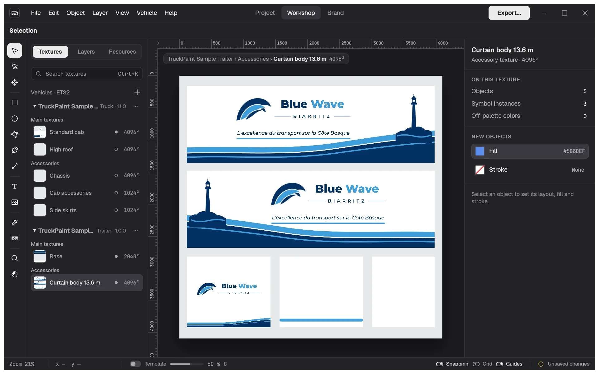

# TruckPaint

Design the paint jobs of your fleet for **Euro Truck Simulator 2** and **American Truck
Simulator**, and export them as a mod that is ready to install.

**Documentation:** <https://truckpaint.ace-dev.me/> (English, French, Spanish, German)

> TruckPaint is in early development. Download it for Windows, Linux or macOS (Apple
> silicon) from the [releases page](https://github.com/acesyde/truckpaint/releases/latest).
> There are no installers yet: unzip the download and run `truckpaint`. To build it
> from source, see [CONTRIBUTING.md](CONTRIBUTING.md).

## What you can do

- **Start from a real vehicle.** Pick an official truck or trailer of the game, or bring
  your own templates. You always paint on the vehicle's template, so your design lands
  in the right place on the truck.
- **Paint a whole fleet.** One project holds several trucks, with the cabins you choose,
  and several trailers of the same game.
- **Draw with vector tools.** Shapes, paths, text, images, gradients, strokes and
  shadows, with layers, guides, snapping and alignment.
- **Keep one brand on every vehicle.** Share a palette, styles and symbols across the
  fleet. Change a color once, and every texture follows.
- **Export the mod.** One click writes the whole fleet as a mod for the game's Mod
  Manager. You can also export one texture as PNG or DDS.
- **Draw with an AI assistant (optional).** Let an assistant in your own MCP client
  (Claude Code, Claude Desktop…) draw on the open project, for example from a photo of a
  real truck. It is off by default, works only on your computer, and every change it
  makes can be undone. See the [AI assistant page](https://truckpaint.ace-dev.me/en/ai-assistant/setup/).

TruckPaint runs on Windows, macOS and Linux, in English, French, Spanish and German.

## Help and feedback

- Read the [documentation](https://truckpaint.ace-dev.me/).
- Report a problem or suggest an idea in the
  [issues](https://github.com/acesyde/truckpaint/issues).
- Want to help? Read [CONTRIBUTING.md](CONTRIBUTING.md).

## Credits and licenses

- TruckPaint is under the MIT license, see [LICENSE](LICENSE).
- Official ETS2 trucks and trailers are made inside the app from your own game
  files (My Game tab of the Vehicle Library), for your own use.
- Fonts: [Geist](https://github.com/vercel/geist-font),
  [JetBrains Mono](https://github.com/JetBrains/JetBrainsMono),
  [Inter](https://rsms.me/inter/) and other fonts for your designs (SIL Open Font
  License, see `assets/fonts/*-LICENSE.txt`). Icons:
  [Phosphor Icons](https://phosphoricons.com/) (MIT).
- Euro Truck Simulator 2 and American Truck Simulator are games by SCS Software.
  TruckPaint is not made by or linked to SCS Software.
